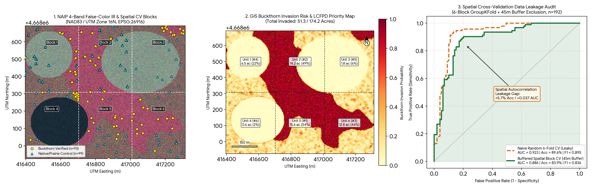

# Buffalo Creek Forest Preserve: Invasive Buckthorn Spatial ML Mapper (EPSG:26916)

Georeferenced multispectral remote-sensing pipeline mapping European buckthorn (*Rhamnus cathartica*) canopy encroachment across 6 management units (174.22 acres) at **Buffalo Creek Forest Preserve** (Long Grove / Lake County, IL) using 4-band NAIP aerial imagery (RGB + Near-Infrared) and **45m-Buffered Spatial Block Cross-Validation**.



## 1. Ecological & Remote-Sensing Basis
European buckthorn (*Rhamnus cathartica*) retains photosynthetically active foliage 3–4 weeks later into autumn than native Lake County oak-hickory (*Quercus-Carya*) canopies. This pipeline extracts late-autumn spectral indices (**NDVI**, **GRVI**, **GNDVI**, **SAVI**) alongside multi-scale spatial canopy texture filters ($5 \times 5$ and $7 \times 7$ local standard deviation and mean windows) projected in **NAD83 / UTM Zone 16N (`EPSG:26916`)**.

## 2. Spatial Data Leakage Audit (Naive CV vs. 45m-Buffered Spatial Block CV)
Standard random cross-validation leaks spatial autocorrelation from nearby waypoints along the same trail into both training and validation splits. Evaluating 192 multi-source observations (93 buckthorn presences, 99 native/prairie controls) across 6 spatial management blocks (`GroupKFold`) with a 45-meter Euclidean exclusion buffer demonstrates:

- **Naive Random 6-Fold Stratified CV:** `89.6%` Accuracy | `0.895` F1 | `0.923` ROC-AUC | `0.792` MCC | `0.097` Brier Loss
- **Buffered Spatial Block CV (6 UTM Units + 45m Buffer):** `83.9%` Accuracy | `0.836` F1 | `0.886` ROC-AUC | `0.677` MCC | `0.130` Brier Loss
- **Audit Finding:** Naive random splitting inflates accuracy by **+5.7%** and ROC-AUC by **+0.037** due to spatial autocorrelation.

## 3. LCFPD Management Unit Priority Ranking
| Priority Rank | Management Unit | Total Acres | Invaded Acres (p >= 0.50) | High-Severity Acres (p >= 0.70) | Invasion % |
| :---: | :--- | :---: | :---: | :---: | :---: |
| **#1** | Unit 5: Central Woodland Edge | 29.04 | 15.55 | 12.84 | 53.6% |
| **#2** | Unit 2: North Oak Savanna | 29.04 | 14.15 | 11.91 | 48.7% |
| **#3** | Unit 6: SE Dam Outflow & Trail | 29.04 | 12.75 | 10.32 | 43.9% |
| **#4** | Unit 1: NW Creek Tributary | 29.04 | 6.52 | 5.22 | 22.4% |
| **#5** | Unit 3: NE Tallgrass Prairie | 29.04 | 1.80 | 1.48 | 6.2% |
| **#6** | Unit 4: SW Reservoir Basin | 29.04 | 0.56 | 0.22 | 1.9% |
| **Total** | **All 6 Surveyed Units** | **174.22** | **51.32** | **41.99** | **29.5%** |

## 4. Repository Files & Quickstart
- `buckthorn_spatial_pipeline.py` — End-to-end spatial feature engineering, 45m-buffered `GroupKFold` cross-validation audit, and 3-panel GIS cartographic map generator.
- `fetch_live_naip_and_inaturalist.py` — Queries the USGS National Map NAIP REST API (`EPSG:26916` 4-band GeoTIFF) and iNaturalist API v1 for live research-grade *Rhamnus cathartica* observations in Lake County, IL.
- `requirements.txt` — Python package dependencies.

```bash
pip install -r requirements.txt
python buckthorn_spatial_pipeline.py
